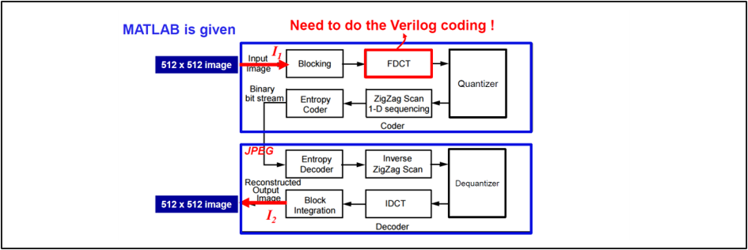
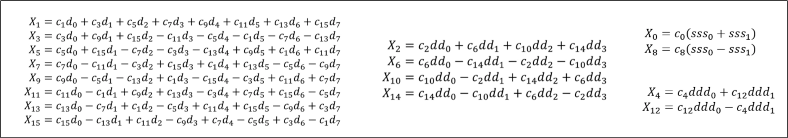
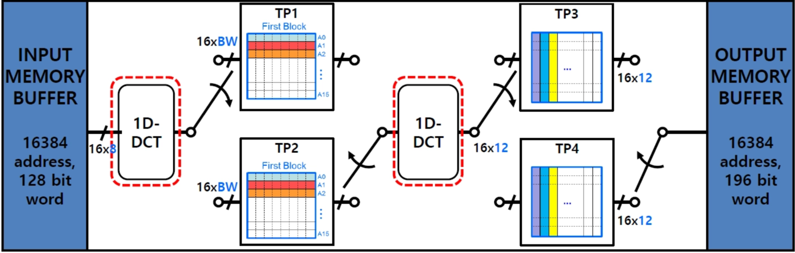

# [VLSI] JPEG - 2D DCT Optimization

## Introduction

  JPEG Codec은 이미지를 Discrete Cosine Transform을 통해 각 픽셀 데이터들을 여러 주파수 성분으로 분해한 후, Quantization 및 Encoding하여 압축하는 방식이다. 각 주파수 성분 및 연산 과정에 Quantization이 필수적으로 포함되므로 압축된 데이터는 손실을 가진다. 해당 JPEG Codec 압축 과정 중, DCT 과정을 Verilog를 통해 설계해보고자 한다.

### DCT

  Discrete Cosine Transform은 위와 같은 식을 통해 수행되며 2D-DCT의 경우는 DCT의 결과로 나온 Matrix를 Transpose하여 DCT를 한번 더 계산하면 구할 수 있다. 이번 프로젝트에선 16-point DCT를 설계할 것이며 따라서 N의 값은 16이 된다.

  DCT를 위와 같이 Matrix Multiplication으로 나타낼 수 있다. Matrix의 식으로 나타낼 경우 Odd와 Even row를 분리할 수 있고 대칭성에 의해 오른쪽과 같이 x(n)의 합과 차의 항으로 나타낼 수 있다. 또한 Even row를 분리한 결과에서 다시 Even과 Odd row로 분리할 수 있고 해당 과정을 반복하게 되면 아래와 같은 식으로 정리된다.

  이렇게 DCT 연산이 한번 진행된 후 결과로 나온 행렬에 Transpose를 하여 다시 DCT 연산을 진행하여야 한다. DCT의 연산은 한 column씩 진행되므로 행렬의 16x16의 요소를 모두 연산해야만 Transpose가 가능하다.
따라서 Transpose를 위해 연산 결과를 축적하는 동안 두번째 DCT의 진행이 불가능해진다. 따라서 이번 프로젝트에선 DCT를 Realtime으로 동작시키기 위해 요소들을 축적한 후 한 clock에 하나의 전치된 요소들을 출력하는 TPmem(Transpose memory)를 하나의 Transpose에 두 개씩 사용하여 하나의 TPmem이 요소들을 축적하는 동안 다른 TPmem이 요소들을 출력하는 것을 서로 번갈아 반복하는 pingpong 방식을 차용하였다.

전체 2D-DCT 모듈 구조는 위와 같다.
Input 데이터의 Bit-width는 8bit, output 데이터의 Bit-width는 12bit으로 고정되어 있다.

제공된 MATLAB Reference 코드를 통해 Coefficient의 Quantization 비트 수를 12bit, 첫번째 1D DCT의 결과 비트 수를 12bit으로 설정하였을 때, 아래와 같은 PSNR의 값을 가지고 이미지가 복원되었다.
가장 작은 PSNR 수치는 30.12dB로 기준인 29dB 값을 만족하는 것을 알 수 있다.

## Optimization

  이번 프로젝트의 목표는 2D-DCT 모듈의 Area, Power의 최적화이다. 따라서 고안한 최적화 기법들을 MATLAB에서 하드웨어와 동치가 되도록 코드를 설계하여 동작 및 PSNR을 검증해보았다.

### Baseline

Coefficient 8bit, 1st 1D DCT result 12bit으로 구성한 Baseline 모델의 PSNR값이다.
### Operation Optimization

  이전에 언급했던 것과 같이, DCT 연산을 대칭성을 이용하여 식을 정리할 경우, 위와 같은 결과가 나온다. 

  Odd row로 분리되었던 식들을 살펴보면 위와 같이 $`(c_a d_n+c_{15-a}d_{p-n}), (c_{15-a}d_{p-n}-c_a d_n)`$ 와 같이 유사한 구조를 가지는 Pair가 반복되는 구조임을 알 수 있다. 위 그림에선 한번의 Even/Odd 분리시 나온 row들만 보여주고 있지만 다른 여러차례의 Even/Odd의 분리를 통해 나온 row들 또한 동일한 구조를 가진다. 이러한 Pair를 하드웨어로 구성할 경우 Multiplier 4개와 Adder 2개를 필요로 함을 알 수 있다.

  해당 식을 연산기의 Area를 가장 최소한으로 가지며 연산하기 위해 Multiplier의 수를 감소시키는 연산 최적화를 진행하였다. 위 그림에서 왼쪽 식은 오른쪽 식으로 표현이 가능하다. 오른쪽과 같은 방식으로 계산을 진행할 경우, 각 t, A, B에서 한번의 곱셈과 한번의 덧셈이 필요하다. 전체 $`\alpha, \beta`$ 를 계산할 경우 3번의 곱셈과 5번의 덧셈을 필요로 하게된다. 따라서 Multiplier의 수가 4개에서 3개로 감소하였으며, Adder의 수가 3개 증가하였음을 알 수 있다.
  또한 Coefficient인 c는 고정된 상수이므로 해당 특성을 살려서 하드웨어 내에 미리 덧셈등의 연산을 진행하여 결과 값을 내장시킬 수 있다. 따라서 Coefficient끼리의 연산 load를 무시할 수 있고, 연산기의 수를 다시 확인해보면, Multiplier 3개, Adder 3개가 결과적으로 필요함을 알 수 있다.

위 전체 식에서 Odd part에 대해 전부 해당 연산으로 교체할 경우 Multiplier가 (21x4+2)개에서 (21x3+2)으로 약 25%가까이 줄어드는 것을 알 수 있다. 해당 연산을 Matlab에서 구현하여 PSNR값을 측정하였을 때 아래와 같은 결과가 나왔다. 최적화시 데이터의 손실이 발생하지 않으므로 Baseline과 동일한 결과임을 알 수 있다.

### Transpose Memory Optimization

현재의 TPmem은 Pingpong 구조를 가지므로 각 Transpose마다 2개의 TPmem을 필요로 하며 각 TPmem read/write 총 2개의 Phase를 가진다. 문제는 한 phase에 있을 때 다른 phase의 동작을 수행하지 못한다는 것이다. 따라서 이 부분을 해결하여 전체 모듈에 사용되는 TPmem의 수를 줄여보았다.

TPmem에서 read를 column에 진행한다고 했을 때 해당 column은 다음 데이터가 들어올 때까지 아무런 동작을 하지 않고 쓰이지 않는 데이터를 담고 있는다. 따라서 동일한 Clock edge에서 read와 write를 동시에 진행하며 read된 값을 D_FF에 넣음으로써 데이터를 Array에 다시 채우는 Phase가 필요 없도록 최적화가 가능하다.

새로 설계한 TPmem은 read와 write의 phase 구분 없이 동작한다. 먼저 한 row씩 Clock의 Positive Edge에서 TPmem의 Array에 in_data를 Write를 진행하며 동시에 out_data의 D_FF로 write를 진행하는 array의 데이터를 read해온다. 동일한 과정을 나머지 row에 대해서도 순차적으로 반복하며 모든 row에 대해 동작을 완료 했을 경우 column에 대해서도 동일한 과정을 반복한다. 이와 같은 방식으로 Transpose를 수행할 수 있다.

이와 같이 최적화를 진행할 경우 2번의 Transpose에 각 2개의 TPmem에서 각 1개의 TPmem으로 TPmem의 수가 감소함을 알 수 있다.

TPmem 최적화 또한 데이터의 손실이 발생하지 않으므로 Baseline과 동일한 PSNR값을 가진다.

### Bit-width Optimization

다음 최적화로는 연산시에 사용되는 Coefficient와 첫번째 1D-DCT의 Truncation 비트 수를 조정하였다.  비트 수를 줄일 때 이전에 최적화시에 하드웨어에 내장시켰던 Coefficient끼리의 연산 결과 또한 동일한 Coefficient 비트 수로 연산시켰을 때의 결과로 변경하도록하였다. MATLAB을 통해 비트 수를 줄여 보았을 때 Coefficient가 6bit, Truncation이 9bit일 때 이후 최적화를 적용할 수 있는 여유가 있는 PSNR 값을 가지며 가장 최소의 비트 수를 가지는 것을 알 수 있었다.

PSNR 측정 결과는 위와 같다. 최소 PSNR은 29.77dB가 나오는 것을 볼 수 있다.

### High Frequency Truncation

보통의 현실 Image에서는 DCT를 수행하였을 때 고주파수 성분은 작은 값을 가지며 비중이 작다. 따라서 고주파수 성분의 중요도가 저주파수 성분에 비해 떨어진다. 이러한 특성을 살려서 고주파수 성분의 연산에 자원을 덜 할당하는 방식으로 최적화를 해보았다.

  중요도가 비교적 낮은 고주파수 성분이 연산되는 부분을 제거하고 출력에 0을 넣는 방식으로 최적화를 하였다. 1D-DCT의 출력을 마지막 행부터 순차적으로 0으로 만들면서 PSNR조건을 29dB이상으로 유지되도록 제거되는 행의 수를 조절하였다. 결과적으로 X[12]~X[15]의 행의 연산을 제거 후 0으로 출력시켰을 때 조건을 만족하며 가장 많은 행을 지울 수 있음을 확인하였다.

PSNR의 결과는 위와 같다. 최소 PSNR은 29.34dB가 나오며 기준을 만족하는 것을 볼 수 있다.

## Implementation

위에서 고안한 최적화 기법들을 Verilog를 통해 적용해보았다.

### Baseline

Coefficient 8bit, 1st 1D-DCT truncation 12bit으로 구현한 Baseline 모듈이다. 단순히 Butterfly 연산만 적용되어있다. Area와 Power는 아래와 같다.

| [μm²] | TP 메모리 | DCT 1st | DCT 2nd | Total |
| --- | --- | --- | --- | --- |
| Baseline | 3,071,864 μm² | 1,894,940 μm² | 2,279,097 μm² | 7,322,178 |

구현된 모듈을 통해 압축을 진행하였을 때 PSNR의 결과 값은 다음과 같다.

PSNR이 MATLAB으로 예측했던 값과 대부분 동일하게 나오지만, 몇몇 이미지에서 overflow가 발생하여 반전된 블록이 존재하는 것을 볼 수 있다. 이는 MATLAB에선 실제 하드웨어와는 다르게 Overflow가 발생하지 않기 때문이다.

### TP_mem Optimization

위에서 고안한 방식으로 TPmem을 최적화 하였다.

| [μm²] | TP 메모리 | DCT 1st | DCT 2nd | Total |
| --- | --- | --- | --- | --- |
| v1(baseline) | 3,071,864 | 1,894,940 | 2,279,097 | 7,322,178 |
| v2 | 2,092,055 | 2,051,232 | 2,280,034 | 6,482,034 |
| Δ (v1→v2) | −979,809 | +156,292 | +937 | −840,144 |

최적화 결과 TPmem의 total Area가 약 980,000 μm² 감소한 것을 볼 수 있다. TPmem이 4개에서 2개로 절반 감소하였지만 TPmem의 Area는 약 68%로 감소하였다. 이는 TPmem의 Control 로직의 복잡도가 증가함에 따라 해당 로직의 Area가 늘어났기 때문으로 예측되며, 실제 리포트 상에서 Control 로직에 해당하는 Combinational Area가 Baseline에 비해 약 350,000 μm²이 증가한 것을 볼 수 있다.

위 최적화 결과에서도 PSNR이 MATLAB으로 예측했던 값과 대부분 동일하게 나오지만, 몇몇 이미지에서 overflow가 발생하여 반전된 블록이 존재하는 것을 볼 수 있다.

### Operation Optimization

위에서 설명했던 DCT의 연산에 사용되는 Multiplier의 수를 줄이는 방식으로 DCT를 구현하였다. 

Coefficient끼리의 연산은 미리 결과 값을 Bit-width에 맞추어 하드웨어에 내장 시켰으며 Coefficient의 곱셈을 위 사진과 같이 상수 곱으로 표현하였다. 

| [μm²] | TP 메모리 | DCT 1st | DCT 2nd | Total |
| --- | --- | --- | --- | --- |
| v1(baseline) | 3,071,864 | 1,894,940 | 2,279,097 | 7,322,178 |
| v4 | 2,083,511 | 704,046 | 819,568 | 3,673,243 |
| Δ (v1→v4) | −988,353 | −1,190,894 | −1,459,529 | −3,648,935 |

최적화를 수행한 후 report를 출력해보았을 때의 결과는 위와 같았다. 각 DCT 모듈의 Area가 약 1/3로 감소한 것을 볼 수 있다. 이전에 Area의 변화를 예측하였을 땐 Multiplier의 수가 25% 감소하며 Adder의 수가 1개 증가하므로 Area가 약 75%의 값을 가질 것으로 예상하였지만 그보다 더 큰 Area가 줄었음을 볼 수 있다.
따라서 Design Compiler를 통해 원인을 분석해보았다.

Design Compiler에서 합성 후 합성된 Netlist 파일을 출력하여 분석해보았다. 위 사진을 보면 t_o8_y50을 5*o8_sum0으로 정의하였는데, 이 부분의 합성된 Netlist를 보았을 때 XNOR3(o8_sum0[7],~o8_sum0[5],carry)로 Design Compiler가 합성을 진행하였음을 알 수 있다. 이는 Full adder와 동치이며 o8_sum0[7]에 o8_sum0[5]을 Carry와 함께 덧셈을 진행하므로  left shift를 2번하여 자기자신과 덧셈한다는 것을 알 수 있다. 
원래 정의로는 상수인 5를 곱하는 것이었고 5는 이진수로 101이므로 5를 곱하면 이진수 곱셈의 특성에 따라 left shift를 2번한 값과 덧셈을 하는 것과 같다. 
t_o8_y50의 다른 bit들을 추적해보았을 때도 동일하게 left shift를 2번해서 덧셈을 진행함을 확인하였다. 따라서 위 결과를 통해 Design Compiler가 자동으로 상수 곱셈을 Shift&Add Tree로 변환했음을 알 수 있다.

구현된 모듈을 통해 PSNR을 구하였을때의 결과는 위와 같다. 압축 과정에서 추가적인 손실이 없으므로 이전과 동일한 결과가 나옴을 알 수 있다.

### Overflow

위 구현에서 발생한 Overflow를 처리하는 로직을 구현하였다. 

각 블록에서 DC성분을 담고 있는 (1,1)과 AC성분 중에서도 비교적 큰 값을 가지는 (1,2), (2,1)에서 Overflow가 자주 발생하며 실제 MATLAB Reference 코드를 통해 DCT 결과 값을 분석해 보았을 때에도 해당 지점의 값이 signed 12bit의 범위를 넘어서게 되어 Overflow가 발생함을 볼 수 있었다.

DC성분은 최종 Truncation에서 1/2배의 값을 담도록 Truncation이 되어 Overflow가 발생하지 않지만 AC (1,2),(2,1)은 2배의 값을 담는다. 따라서 AC성분 2개는 DCT의 Truncation전 단계에서 전체 sign bit과 Truncation된 후의 sign bit이 다를 경우 overflow로 간주하여 기존의 sign을 가지는 12bit 최대값을 담도록 로직을 설계하였다.

| [μm²] | TP 메모리 | DCT 1st | DCT 2nd | Total |
| --- | --- | --- | --- | --- |
| v1(baseline) | 3,071,864 | 1,894,940 | 2,279,097 | 7,322,178 |
| v5 | 2,087,331 | 697,350 | 821,800 | 3,665,314 |
| Δ (v1→v5) | −984,533 | −1,197,590 | −1,457,297 | −3,656,864 |

해당 로직을 추가하였을 때의 Area 변화는 다음과 같다. 단순히 Mux를 추가한 것이므로 Area의 변화가 크지 않은 것을 볼 수 있다.

PSNR 값들이 이전에 MATLAB으로 출력했던 값들과 비슷한 값을 가지도록 고쳐졌음을 알 수 있다. 약간의 차이가 존재하는 것은 MATLAB에선 Overflow를 따로 처리하지 않았기 때문이며 이는 이전에 Overflow가 많이 발생하던 이미지에서 PSNR의 차이가 큼을 통해 알 수 있다.

### Bit-width Optimization

DCT에 내장된 Coefficient를 6bit으로 Quantization 및 1st 1D DCT의 output을 9bit으로 truncation하도록 구현하였다. 이에 따라 1st TPmem의 bit-width도 줄였다. 

| [μm²] | TP 메모리 | DCT 1st | DCT 2nd | Total |
| --- | --- | --- | --- | --- |
| v1(baseline) | 3,071,864 | 1,894,940 | 2,279,097 | 7,322,178 |
| v7 | 1,906,627 | 480,043 | 505,649 | 2,950,743 |
| Δ (v1→v7) | −1,165,237 | −1,414,897 | −1,773,448 | −4,371,435 |

Report를 통해 출력한 Area의 결과는 위와 같았다. 각 DCT의 모듈에서 200,000~300,000 μm²의 Area감소가 이루어 졌으며 TPmem도 소폭 감소하였다.

PSNR을 출력하였을 때 결과는 다음과 같다. 최소 PSNR값이 29.78로 최소 기준을 만족함을 볼 수 있다.

### High Frequency Truncation

X[12]~X[15]의 연산 로직 제거 후 output을 0으로 채우는 최적화를 하였다. 첫번째 1D-DCT의 결과는 12x16의 행렬로 출력되며 따라서 최적화된 TPmem을 사용할 경우 Input이 Column과 row로 번갈아가며 들어오므로 12x16 TPmem은 사용이 불가능하며 16x16의 TPmem을 유지했다. 하지만 두번째 1D-DCT의 경우는 column과 row가 둘 다 4개씩 감소하였으므로 12x12의 TPmem이 사용 가능해진다. 따라서 두번째 TPmem은 12x12 TPmem으로 교체하였다.

| [μm²] | TP 메모리 | DCT 1st | DCT 2nd | Total |
| --- | --- | --- | --- | --- |
| v1 | 3,071,864 | 1,894,940 | 2,279,097 | 7,322,178 |
| v9 | 1,444,841 | 374,172 | 363,189 | 2,248,580 |
| Δ (v1→v9) | −1,627,023 | −1,520,768 | −1,915,908 | −5,073,598 |

결과적으로 TPmem은 500,000 μm², DCT는 각각 100,000~200,000 μm² Area가 감소하였다. 

해당 최적화된 모듈의 PSNR을 측정하였을때의 결과는 위와 같다. PSNR의 최소치는 29.34dB로 최소 기준치를 충족하였다.

| 항목 | v1 (baseline) | v9 (final) | Δ |
| --- | --- | --- | --- |
| Total Area | 7,322,178 | 2,248,580 | **−5,073,598 (−69.3%)** |
| Timing slack | 0.00 MET | 0.00 MET | — |
| Dynamic Power | 125.5 mW | 52.8 mW | **−57.9%** |

최종 구현 결과이다. Report와 Schematic은 Appendix에서 볼 수 있다.

Baseline기준 약 5,000,000 μm², 69.3%의 Area가 감소하였으며 면적의 감소에 따라 Dynamic Power 또한 125.5mW에서 52.8mW로 감소한 것을 볼 수 있다.

Critical path의 경우, 가장 연산량이 많고 path가 긴 DCT 모듈이 잡히며 DCT 모듈 중 첫번째 DCT가 잡히는 것을 볼 수 있다.

### Timing Diagram

각 DCT 모듈이 Error의 발생 없이 잘 동작함을 확인하였다.

## Summary

|  | Total Area | slack | Power |
| --- | --- | --- | --- |
| baseline | 7,322,178 | MET | 125.5 |
| TP_mem Optimization | 6,482,034 | MET | 81.6 |
| Operation Optimization | 3,673,243 | MET | 81.6 |
| Overflow | 3,665,314 | MET | 81.6 |
| Bit-width Optimization | 2,950,743 | MET | 74.3 |
| High Frequency Truncation | 2,248,580 | MET | 52.8 |

## Appendix.

